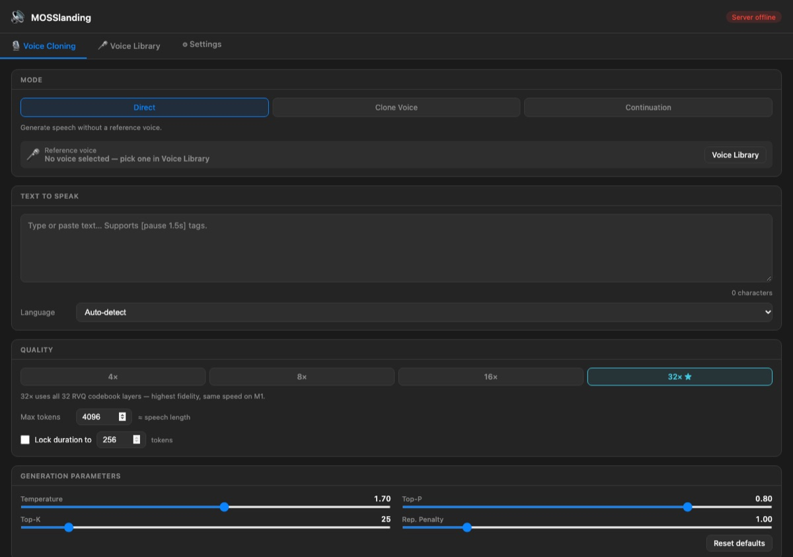

# MOSSlanding

### Offline voice cloning for your desktop, powered by MOSS-TTS

Clone a voice from a short sample, generate speech in 31 languages, and keep
every audio file on your own machine. No account, no cloud, no per-character
billing.



MOSSlanding is a native desktop launcher for the open
[MOSS-TTS](https://github.com/OpenMOSS/MOSS-TTS) model family. It is **not** the
model itself: it downloads the weights, runs them locally, and gives you a
desktop UI for voice cloning, a voice library, and generation settings.

## Status

| Platform | Status | How to install |
|---|---|---|
| macOS 13+ (Apple Silicon) | **v1.0 available** | [DMG release](https://github.com/xirtus/MOSSlanding/releases/download/v1.0/MOSSlanding-1.0.dmg) |
| Linux (NVIDIA) | Source available; no prebuilt binary yet | `cd linux && bash install.sh` |
| Windows 10/11 (NVIDIA) | Source available; no prebuilt installer yet | `powershell -ExecutionPolicy Bypass -File windows/install.ps1` |
| Intel Mac | Not supported/tested | — |

The v1.0 macOS build is **ad-hoc signed, not notarized**. macOS may block the
first launch. See [docs/TROUBLESHOOTING.md](docs/TROUBLESHOOTING.md) and issue
#1. A signed and notarized build is the next release task.

## Install on macOS

1. Download **[MOSSlanding-1.0.dmg](https://github.com/xirtus/MOSSlanding/releases/download/v1.0/MOSSlanding-1.0.dmg)**.
2. Check the SHA-256:
   ```
   a75c32b005b7461ddf589ddd2a41ae5ff29a8f9b1f8f239fdf51d26414930d02
   ```
3. Open the DMG and drag **MOSSlanding.app** to `/Applications`.
4. Run the one-time setup so Python dependencies live in Application Support:
   ```bash
   cd mac && bash setup.sh
   ```
5. Launch MOSSlanding. If macOS blocks it, see
   [Troubleshooting](docs/TROUBLESHOOTING.md).

Requirements: macOS 13+, Apple Silicon (M1/M2/M3/M4), 16 GB RAM recommended,
Python 3.10+.

## Build from source

### macOS

```bash
git clone https://github.com/xirtus/MOSSlanding
cd MOSSlanding
cd mac && bash setup.sh
```

### Linux

```bash
git clone https://github.com/xirtus/MOSSlanding
cd MOSSlanding
cd linux && bash install.sh
```

See [`linux/README.md`](linux/README.md) for the current Linux requirements and
desktop-entry details.

### Windows

```powershell
git clone https://github.com/xirtus/MOSSlanding
cd MOSSlanding
powershell -ExecutionPolicy Bypass -File windows/install.ps1
```

See [`windows/README.md`](windows/README.md) for the current Windows
requirements.

## Features

- **Voice cloning** from a 5–30 second reference sample.
- **31 languages**, with automatic language detection.
- **Voice library** for keeping reference voices and generated takes.
- **Direct / Clone / Continuation** modes.
- **Pause control** with tags such as `[pause 1.5s]`.
- **Local generation** on Apple Silicon (MPS) or NVIDIA (CUDA).
- **Model auto-unload** after inactivity to release memory.

## Models

The app uses:

- `OpenMOSS-Team/MOSS-TTS-v1.5` — voice cloning and direct generation.
- `OpenMOSS-Team/MOSS-VoiceGenerator` — voice design from text descriptions.
- `OpenMOSS-Team/MOSS-Audio-Tokenizer` — audio encoding/decoding.

Model weights are downloaded at runtime and are subject to their upstream
licenses. See [THIRD_PARTY_NOTICES.md](THIRD_PARTY_NOTICES.md).

## Privacy and consent

Everything runs locally. Your reference audio and generated audio do not leave
your machine unless you share them.

Only clone voices you have permission to use. Do not use MOSSlanding to
impersonate real people, bypass consent, or create deceptive audio. If you
publish generated audio, disclose that it is synthetic.

## Known issues / roadmap

- [ ] Notarize and sign the macOS build (issue #1).
- [ ] Ship a tested Linux AppImage or `.deb`.
- [ ] Ship a tested Windows installer.
- [ ] Add before/after audio samples and a 30-second demo video.
- [ ] Add automated install tests on clean machines.
- [ ] Add a one-command Homebrew cask.

## License

MOSSlanding’s source is **MIT** — see [LICENSE](LICENSE). MOSS-TTS and the model
weights are **Apache-2.0** or their own upstream terms — see
[THIRD_PARTY_NOTICES.md](THIRD_PARTY_NOTICES.md).

## Credits

Built by Andreas Xirtus. The models and the underlying research are by the
OpenMOSS / MOSI.AI team; this project is an independent desktop launcher.
